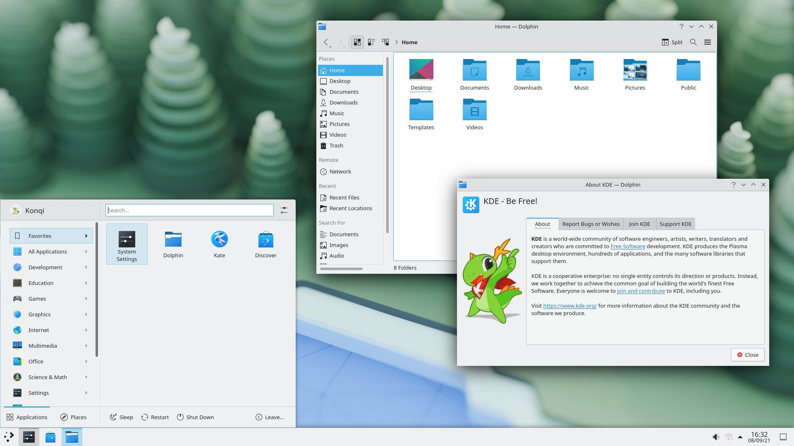
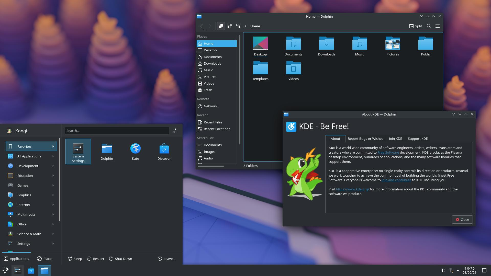
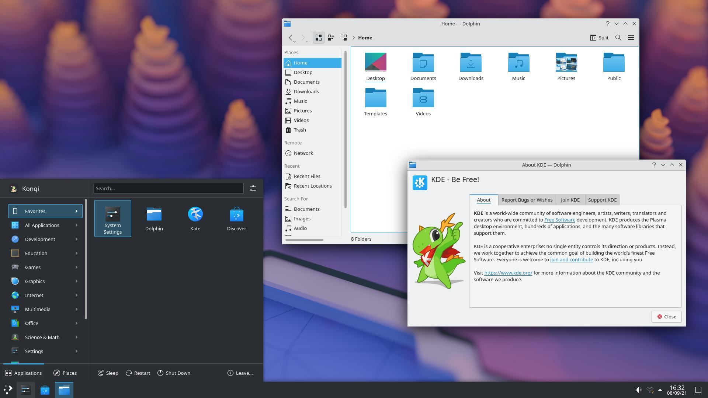

<div align="center">
  <h1> Breeze 🎨 </h1>
</div>

### 📂 Project Structure

```text
.
├── color-schemes
├── grub
├── icons
├── konsole
├── plasma
├── plymouth
├── sddm
├── themes
├── delete.sh
├── install.sh
└── README.md
```

### ⚙️ Installation & Usage

1. Clone the repository.
2. Navigate to the folder: `cd breeze`
3. Run the installer: `chmod +x install.sh && ./install.sh`
4. To uninstall: `chmod +x delete.sh && ./delete.sh`

### 📽️ Visuals & Results

#### org.kde.breeze.desktop



#### org.kde.breezedark.desktop



#### org.kde.breezetwilight.desktop



### 🎨 Other themes

- [Catppuccin](https://github.com/akshatjasrotia85/catppuccin)
- [Sweet](https://github.com/akshatjasrotia85/sweet)
- [Dracula](https://github.com/akshatjasrotia85/dracula)
- [Nordic](https://github.com/akshatjasrotia85/nordic)
- [Gruvbox](https://github.com/akshatjasrotia85/gruvbox)
- [Everforest](https://github.com/akshatjasrotia85/everforest)
- [Tokyonight](https://github.com/akshatjasrotia85/tokyonight)
- [Kanagawa](https://github.com/akshatjasrotia85/kanagawa)
- [Osaka](https://github.com/akshatjasrotia85/osaka)
- [RosePine](https://github.com/akshatjasrotia85/rosepine)
- [Nightfox](https://github.com/akshatjasrotia85/nightfox)
- [Material](https://github.com/akshatjasrotia85/material)
- [Yaru](https://github.com/akshatjasrotia85/yaru)
- [Mac](https://github.com/akshatjasrotia85/mac)
- [Win](https://github.com/akshatjasrotia85/win)
- [Minecraft](https://github.com/akshatjasrotia85/minecraft)
- [Monochrome](https://github.com/akshatjasrotia85/monochrome)
- [OneDark](https://github.com/akshatjasrotia85/onedark)
- [OneHalf](https://github.com/akshatjasrotia85/onehalf)
- [CachyOS](https://github.com/akshatjasrotia85/cachyos)
- [RedPastel](https://github.com/akshatjasrotia85/red-pastel)
- [Nothing](https://github.com/akshatjasrotia85/nothing)
- [Plastik](https://github.com/akshatjasrotia85/plastik)
- [Lightly](https://github.com/akshatjasrotia85/lightly)
- [Darkly](https://github.com/akshatjasrotia85/darkly)
- [Klassy](https://github.com/akshatjasrotia85/klassy)
- [Vinyl](https://github.com/akshatjasrotia85/vinyl)

### 📜 Original Works

- [Breeze GTK](https://github.com/KDE/breeze-gtk)
- [Breeze KDE/Color/Cursor/Wallpaper](https://github.com/KDE/breeze)
- [Breeze Icon](https://github.com/KDE/breeze-icons)
- [Breeze Plymouth](https://github.com/KDE/breeze-plymouth)
- [Breeze GRUB](https://github.com/KDE/breeze-grub)
- [Breeze Konsole](https://github.com/KDE/konsole)
